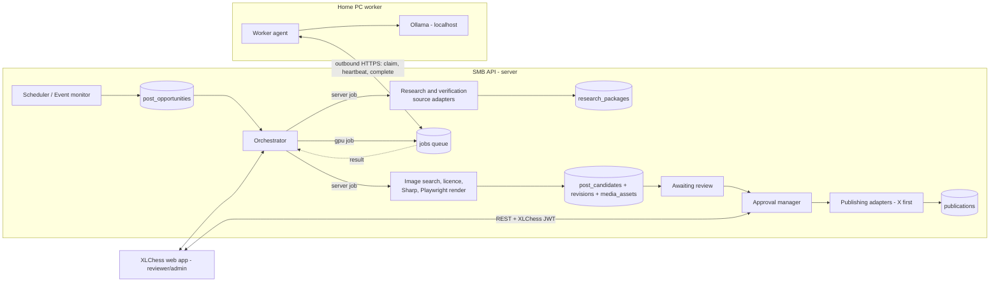

# SMB — Architecture & Implementation Plan (Module 1.1)

Status: **Draft for review** · Author: Harsh Mahatha · Date: 3 Nov 2026

This is the 1.1 deliverable: the data flow, interfaces, worker boundaries, failure paths and infrastructure for SMB. It also walks through the first use case, World Championship (PT 1.1), from start to finish.

---

## 1. Scope and boundaries

| System | Owns | Lives in |
|---|---|---|
| **SMB API** (this repo, `apps/api`) | Configuration, scheduler, event monitor, source adapters, research & verification, job queue, image/licence pipeline, rendering, approval logic, publishing adapters, audit, metrics | This repo, deployed on the same host as the XLChess backend |
| **SMB Worker** (this repo, `apps/worker` + `installer/`) | Runs local AI on the home PC: claims jobs, runs Ollama, returns results. **No social credentials, no inbound ports.** | Home PC (Windows 10, RTX 4070) |
| **XLChess web app** (separate repo) | Reviewer and admin screens. Calls the SMB API only. | XLChess codebase |
| **SMB Supabase project** (separate from XLChess) | Postgres (schema `smb`) and Storage buckets for original and generated media | Supabase |

Fixed by these decisions:
- SMB has **no UI**. Everything a reviewer or admin does is a REST call made by the XLChess app.
- SMB uses its **own Supabase project**. XLChess user ids are stored as plain references, with no cross-project foreign keys.
- Authentication comes from **XLChess's custom auth**: SMB verifies the XLChess-issued JWT and keeps its own role table.
- AI runs **locally on the home-PC worker**. Dev and tests use a deterministic **stub provider**. No paid AI API in V1.

---

## 2. Technology stack

| Concern | Choice | Notes |
|---|---|---|
| Language / runtime | TypeScript, Node.js 22 LTS | Shared types between the API and the worker |
| HTTP framework | **Express 5** | Native async error handling. Zod middleware for validation. |
| Validation and contracts | **Zod** | Config files, request/response DTOs, AI output, worker job payloads. OpenAPI is generated from it (`@asteasolutions/zod-to-openapi`) so XLChess can generate a typed client. |
| Database | Postgres (Supabase, separate project), schema `smb` | The API connects directly over the pooler using a server-only role. The schema is not exposed to PostgREST. |
| Migrations | **Supabase CLI** (`supabase/migrations/*.sql`) | SQL is the source of truth |
| ORM | **Prisma** (client only) | `prisma db pull` → `prisma generate` after each migration. **`prisma migrate` is never used.** Job claiming uses `$queryRaw` with `FOR UPDATE SKIP LOCKED`. |
| Job queue | Postgres `jobs` table | No Redis or broker (per the guide) |
| Scheduler | `node-cron` in the API process, guarded by a Postgres advisory lock | The lock prevents double-firing if two instances run |
| Object storage | Supabase Storage (S3-compatible) | Buckets `originals` (immutable), `renders`, `evidence` |
| Image processing | Sharp | Only crop, resize, rotate and position on originals |
| Graphic rendering | HTML/CSS templates → Playwright screenshot | Deterministic. Fonts are bundled. |
| Local AI | Ollama + Qwen3 8B (quantised) as the first candidate | The model choice is configurable and benchmarked in Phase 3 |
| Logging | pino (JSON) with secret redaction | |
| Tests | Vitest + Supertest; Testcontainers Postgres for integration tests | |
| Repo tooling | npm workspaces | |

---

## 3. Repository layout

```text
XLChess-SMB/
  apps/
    api/                      Express server: REST API, scheduler, server-side job runner
      src/
        http/                 routers, auth middleware, error handler, OpenAPI
          routes/review/      reviewer endpoints (queue, candidates, actions)
          routes/admin/       configs, jobs, workers, prompts, publish mode
          routes/worker/      device-token endpoints for the home PC
        core/
          orchestrator/       opportunity state machine; calls services and holds no domain logic
          workflow/           step definitions, transition guards, retry policy
          scheduler/          cron → opportunities
          events/             trigger ingestion (1.16)
          queue/              enqueue, claim, lease, reaper, idempotency
        config/               loader + validation of /config JSON, runtime overrides
        sources/              SourceAdapter implementations (fide/, chesscom/, lichess/, twic/, …)
        research/             normalisation/, identity/, verification/, package builder
        generation/           prompt templates, output schemas, claim checker
        images/               search/, licensing/, integrity/, composition/, templates/
        review/               approvals/, revisions/, feedback/
        publishing/           PublishingAdapter + x/ (facebook/, instagram/, discord/ later)
        storage/              Supabase Storage wrapper, content hashing
        auth/                 XLChess JWT verification, role checks, device tokens
        monitoring/           metrics, KPIs, alerts
        db/                   Prisma client, raw SQL helpers
      prisma/schema.prisma    introspected and never hand-edited
    worker/                   Home-PC agent (Node, packaged as a Windows service)
      src/
        client/               SMB API client (claim, heartbeat, complete, fail)
        runners/              job handlers by kind (story-select, candidates, …)
        ai/                   Ollama client (localhost only)
        health/               GPU/VRAM/disk probes (nvidia-smi)
  packages/
    shared/                   Zod schemas + TS types shared by api & worker
      src/jobs/               job kinds, payload/result schemas, versions
      src/config/             post-type config schema
      src/api/                DTOs for the XLChess client
  config/
    post-types/1.1-world-championship.json
    sources.json
    channels.json
    templates/                graphic templates (HTML/CSS + manifest)
  supabase/
    migrations/               SQL migrations (source of truth)
    seed.sql
  installer/
    setup-xlchess-worker.ps1  plus update/repair/diagnose/uninstall scripts
  tests/
    unit/ integration/ end-to-end/ fixtures/
  docs/
```

---

## 4. Logical components and their interfaces

The **orchestrator** only moves an opportunity through states and enqueues the next step. All domain work sits behind these interfaces, and new post types, sources and channels are added by **implementing an interface plus configuration**.

```ts
// Source adapters (1.4): one adapter per approved provider, behind SourceGateway
interface ChessDataSource {
  id: string;                                   // "D3"
  adapterVersion: string;
  fetchEvents?(q: EventQuery, ctx): Promise<RawItem<ChessEvent>[]>;   // only what the provider supports
  fetchPlayers?(q: PlayerQuery, ctx): Promise<RawItem<ChessPlayer>[]>;
  fetchGames?(q: GameQuery, ctx): Promise<RawItem<ChessGame>[]>;
  fetchNews?(q: NewsQuery, ctx): Promise<RawItem<ChessNews>[]>;
}
// The rest of SMB calls only: gateway.fetch(sourceId, capability, query) -> Sourced<T>[] (data + provenance)

// AI provider (1.7): implemented by the worker (Ollama) and by StubProvider
interface AiProvider {
  generate<T>(task: AiTask<T>): Promise<AiResult<T>>; // output is validated with task.schema (Zod)
}

// Image sources (1.8)
interface ImageSource {
  id: string;                                   // "I1".."I4"
  search(q: ImageQuery): Promise<ImageCandidate[]>;
  licence(c: ImageCandidate): Promise<LicenceEvidence>; // rejects when unclear
}

// Renderer (1.10): deterministic, with the same inputs giving the same output hash
interface Renderer {
  render(t: TemplateRef, data: RenderData, assets: AssetRef[]): Promise<RenderedAsset>;
}

// Publishing adapters (1.13, 1.23)
interface PublishingAdapter {
  channel: 'x' | 'facebook' | 'instagram' | 'discord';
  validate(pkg: ApprovedPackage): ChannelCheck;          // length, media, alt text
  publish(pkg: ApprovedPackage, idemKey: string): Promise<PublishResult>;
  lookup(idemKey: string): Promise<PublishResult | null>; // safe recovery after a timeout
}
```

Rules:
- Statistics such as rating changes and scores are **computed in code** inside `research/`. The LLM only writes prose around facts it is given.
- Every generated claim has to map to a `claimId` in the research package. The claim checker removes or flags anything unsupported.
- Source text is passed to the model as **quoted, untrusted data**. Prompts never put source text in the instruction position.

---

## 5. End-to-end data flow



### Job lanes
One `jobs` table, with two lanes:
- **`server`**: research, image search and licensing, rendering, publishing. Run by an in-process runner in the API, which has network access, storage and credentials.
- **`gpu`**: story selection, candidate writing, revision-from-feedback. Claimed only by paired workers. Start at concurrency 1, then benchmark.

### Opportunity lifecycle (from the guide)

```text
pending → researching → generating → awaiting_review → approved → scheduled → publishing → published
            │              │               │              │            │
            └──> failed    └──> failed     ├──> rejected  └──> deferred└──> partially_published / failed (per channel)
                                           ├──> deferred
                                           └──> researching (request research) / generating (regenerate)
```

- Each transition is a **guarded function** in `core/workflow`, so no code path can jump states.
- Each step is its own job with its own retries. A failed render **does not re-run research**.
- Publishing is tracked **per channel** in `publications`. A failed Instagram post never re-posts to X or re-renders the image.

### Approval binding
- An edit creates a new **immutable `post_revision`** with `content_hash = sha256(caption, channel texts, asset hashes, template version)`.
- Approval records `(revision_id, content_hash, reviewer_id, timestamp)`.
- Publishing re-computes the hash and refuses if it differs, if the reviewer has lost their role, or if licence or attribution checks fail.

---

## 6. Worker boundary and protocol

The home PC only ever makes **outbound HTTPS** calls to `/worker/v1/*`. It authenticates with a **device token**: opaque, stored hashed in `smb.workers`, revocable, and scoped to worker endpoints only.

| Endpoint | Purpose |
|---|---|
| `POST /worker/v1/pair` | Swap a short-lived pairing code (made by an admin in XLChess, 10-minute TTL, single use) for a device token |
| `GET  /worker/v1/config` | Desired state: paused, concurrency, model list, prompt/config versions, target worker version |
| `POST /worker/v1/status` | Device heartbeat: GPU/VRAM/disk, Ollama state, current jobs |
| `POST /worker/v1/jobs/claim` | Atomically claim the highest-priority eligible `gpu` job (`SKIP LOCKED`). Returns the payload, `leaseId` and `leaseExpiresAt`. |
| `POST /worker/v1/jobs/:id/heartbeat` | Extend the lease and report progress. The response can say `cancel`. |
| `POST /worker/v1/jobs/:id/complete` | Submit the result. **Idempotent** on `(jobId, leaseId)`: a duplicate submit returns the first outcome. |
| `POST /worker/v1/jobs/:id/fail` | Report an error and whether it is retryable |
| `POST /worker/v1/logs` | Batched log upload, redacted |

Recovery:
- A **lease reaper** in the API finds expired leases, re-queues the job with `attempts+1`, and marks it `dead` after `maxAttempts` (taken from the post type's `retryPolicy`).
- The worker writes a **local checkpoint** for each job. After a restart it re-claims through the normal flow; it never replays a stale lease.
- Results are stored **only** through `complete`, inside a transaction, so a crash can't leave a half-written candidate set.
- Stale work expires: each job has a `notAfter`, so a game recap that is 2 days old gets reconsidered, not generated.

The **installer** (`setup-xlchess-worker.ps1`) handles: preflight checks (OS, GPU driver, VRAM, RAM, disk, network), installing Ollama and pulling the model, installing the worker as a Windows service (NSSM or a scheduled task with restart-on-fail), checking power and sleep settings, pairing, and running a test job with a GPU check. It ships with `update`, `repair`, `diagnose` and `uninstall` scripts. **Which module builds this is still open** (README open point). This plan puts it in Phase 3, alongside 1.7.

---

## 7. API surface for XLChess (reviewer and admin)

All routes are under `/v1` and need `Authorization: Bearer <XLChess JWT>`.

| Area | Representative endpoints | Role |
|---|---|---|
| Review queue | `GET /v1/review/queue`, `GET /v1/opportunities/:id` (candidates, revisions, research claims with source links, assets, licences, channel previews, publication history) | reviewer |
| Edit | `POST /v1/candidates/:id/revisions` | reviewer |
| Actions | `POST /v1/revisions/:id/approve` (body: `contentHash`, `channels`, `scheduledFor?`), `POST /v1/opportunities/:id/{reject,defer,regenerate,request-research}` | reviewer |
| Publishing | `GET /v1/publications`, `POST /v1/publications/:id/retry` | admin |
| Config | `GET/PUT /v1/admin/post-types/:id/overrides`, `GET /v1/admin/configs/versions` | admin |
| Queue & workers | `GET /v1/admin/jobs`, `POST /v1/admin/jobs/:id/{retry,cancel,reprioritise}`, `GET /v1/admin/workers`, `POST /v1/admin/workers/pairing-codes`, `POST /v1/admin/workers/:id/{pause,resume,revoke}` | admin |
| Prompts / models | `GET/POST /v1/admin/prompts`, `PUT /v1/admin/workers/:id/models` | admin |
| Publish mode | `GET/PUT /v1/admin/publish-mode` | admin (+ env gate) |
| Metrics | `GET /v1/metrics/*` | reviewer |
| Contract | `GET /v1/openapi.json` | public |

Errors use one shape: `{ error: { code, message, details? } }`. Mutating reviewer actions accept an `Idempotency-Key` header.

---

## 8. Security model (detailed in 1.18)

- **User auth**: verify the XLChess JWT. Algorithm and key (HS256 secret or RS256 JWKS URL), issuer and audience all come from env. SMB keeps `smb.user_roles (xlchess_user_id, role)` with the roles `viewer`, `reviewer`, `admin`.
- **Worker auth**: device tokens, as described in §6. A worker token cannot reach `/v1/*`.
- **Social credentials** stay in the API host's secret env only. They are used only by `publishing/`, never sent to the worker, and never returned by any endpoint. Logger redaction is enforced by a test.
- **Publish mode**: `dry_run` (the default; records what *would* be posted), `sandbox`, `live`. Setting `live` needs **both** `SMB_ALLOW_LIVE_PUBLISH=true` in env **and** an admin toggle, which is audited.
- **Audit log**: every privileged action (approve, publish-mode change, pairing, revoke, config override) is written to `smb.audit_log`.
- Separate dev and prod Supabase projects, and separate X apps and credentials.

---

## 9. Failure paths

| Failure | Handling |
|---|---|
| Source down or rate-limited | Adapter retries with backoff. The research step fails alone and is retried. Partial packages are flagged, not passed off as complete. |
| Conflicting facts between sources | The claim is marked `unverified`. A required claim that stays unverified blocks generation and asks for more research. |
| Worker offline | GPU jobs wait in the queue, and the admin UI shows the worker as offline. Time-sensitive jobs past `notAfter` expire. |
| Worker crash mid-job | The lease expires, the reaper re-queues, and bounded retries end in `dead` with an alert |
| AI output invalid (fails schema or has an unsupported claim) | Repaired or retried up to N times, then the step fails. Never shown to a reviewer as valid. |
| No licensable image | The photo is rejected. The pipeline falls back to the template's no-photo variant or flags the opportunity. |
| Render failure | Only the render step is retried |
| Revision edited after approval | The hash mismatch invalidates the approval, and the post goes back to `awaiting_review` |
| X publish timeout | `lookup(idemKey)` runs **before** any retry, so the post is never double-posted |
| One channel fails | Only that `publications` row is retried |
| API restart | All state is in Postgres. Cron is re-derived, server jobs with expired leases are re-queued, and the advisory lock stops duplicate schedulers. |

---

## 10. Reference use case: World Championship (PT 1.1)

Config: `config/post-types/1.1-world-championship.json`. Sources D1–D5, images I1–I4, channels X/FB/IG/Discord (X only in V1), normal schedule Friday 09:00 UTC, tournament phase "after each completed game", 3 candidates, approval mandatory.

Walkthrough (tournament phase):
1. The event monitor sees game N finish (1.16), and the phase resolver says `tournament` (1.15). It creates an opportunity with a dedupe key `1.1:wcc-2026:game-N`.
2. The research job pulls the result, PGN and standings from the approved sources. Code computes the score and standings, cross-checks the result across two sources, and produces a research package with `claimId`s.
3. The story-selection GPU job picks the angle (1.6).
4. The candidate GPU job writes 3 captions, each citing `claimId`s. The claim checker validates them (1.7).
5. The image job finds photos in I1–I4 and records licence evidence. Sharp crops the originals, Playwright renders the game-result template, and hashes are stored (1.8–1.10).
6. The opportunity moves to `awaiting_review`. The XLChess UI shows 3 candidates with previews, sources and licences (1.11).
7. The reviewer edits candidate B (creating revision 2) and approves revision 2 with its hash.
8. The publishing step runs pre-flight checks, then posts to X in dry-run until live is enabled. It stores the tweet id and URL (1.13).

Phase 4 acceptance includes **recreating the Gukesh–Sindarov trial post** from the original photographs. I need that trial post and its assets from the manager.

---

## 11. Phased delivery mapped to modules

| Phase (guide) | Modules | Deliverable |
|---|---|---|
| 1. Design | **1.1**, 1.2, 1.3 | This doc, the `smb` schema with migrations, and post-type config schema + 1.1 config |
| 2. Data | 1.4, 1.5 | Source registry, first adapter, verified research package for PT 1.1 |
| 3. Generation | 1.6, 1.7, **worker + installer** | Story selection, 3 validated candidates via the stub provider, then via the paired home PC |
| 4. Images | 1.8, 1.9, 1.10 | Licensed photos, immutable originals, deterministic render of the trial post |
| 5. Review | 1.11, 1.12 | Reviewer API, revisions, approval binding, feedback capture |
| 6. X | 1.13, 1.18 | Dry-run, then live, X publishing with duplicate safeguards |
| 7. Automation | 1.14, 1.15, 1.16, 1.17 | Scheduling, phases, event triggers, recovery |
| 8. Complete | 1.19, 1.20, 1.21, then 1.22, 1.23 | KPIs, test suite, deployment docs; then more post types and channels |

Immediate next steps after this design is approved:
1. Scaffold the monorepo (npm workspaces, TS config, Express app with health and OpenAPI, shared package, Vitest, lint) and set up the Supabase CLI.
2. 1.2: write the `smb` schema migrations, then `prisma db pull` (done, see section 13).

---

## 13. Database schema and provenance (Module 1.2)

Migrations are in `supabase/migrations/`, dev fixtures in `supabase/seed.sql`, and the tests in `tests/integration/db/` (`npm run test:integration`, needs Docker or `SMB_TEST_DATABASE_URL`).

### Tables

| Area | Tables |
|---|---|
| Configuration and sources | `post_types`, `post_configs` (versioned, immutable, one active per type), `data_sources` (data `D*` and image `I*`), `source_records` |
| Work | `post_opportunities` (pinned to an exact `post_configs` row), `opportunity_events` (status history), `jobs` |
| Research | `research_packages`, `research_claims`, `research_claim_sources` (claim to source record, many to many) |
| Content | `post_candidates` (slots A/B/C per generation cycle), `post_revisions` (immutable, hashed), `revision_claims`, `revision_assets` |
| Media | `media_assets` (original, derived, render, evidence), `media_licenses` |
| Review and publishing | `review_actions`, `publications` (one row per approval and channel), `publication_attempts` |
| Operations | `post_metrics`, `audit_log`, `retention_policies` |

`post_revisions` is not in the guide's table list, but "one candidate can have multiple revisions" needs it.

### Rules enforced by the database
- **Append-only history.** Revisions, review actions, claims, licences, status events, candidates, attempts, metrics and the audit log cannot be updated or deleted (`smb.immutable_except()`). A few columns stay writable: publication status fields, `media_assets.deleted_at`, `source_records.raw_payload`, and `post_configs.is_active`.
- **Approval binding.** An `approve` action must carry the exact `content_hash` of its revision, and a publication must match its approval's revision, hash and approved channel. Changing the text after review therefore cannot be published under the old approval.
- **Image provenance.** An original has a source URL and image source. A derived asset has a parent and a transform. A render has a template version. An accepted licence must allow commercial use and have a licence URL or saved evidence.
- **Status history.** A trigger writes `opportunity_events` on every status change. Set `smb.actor`, `smb.reason` and `smb.job_id` with `set_config(..., true)` inside the transaction to record who and why.
- **No client access.** `anon` and `authenticated` have no privileges on the `smb` schema.

### Tracing a post
`smb.publication_provenance` returns, per publication: the approval and reviewer, the revision (number, author, hash), the generation (provider, model, prompt version, job), the exact config version, the research package, every cited claim with its source URL, retrieval time and payload hash, every asset with its original photo, source URL and licence, and the status history.

### Retention (`smb.apply_retention(now)`)
Defaults live in `smb.retention_policies` and can be edited:

| Subject | Default | Effect |
|---|---|---|
| `source_raw_payload` | 90 days | `raw_payload` is cleared. URL, hash and normalised record stay. |
| `unused_image` | 30 days | Original and derived images that never reached an approved revision get `deleted_at`. |
| `unused_render` | 30 days | Same for rendered graphics. |
| `job_payload` | 30 days | Payload and result of finished jobs are cleared. The row stays. |

Anything used by an approved or published revision, its ancestor originals, and licence evidence are never touched. The function only marks rows. Removing the files from Storage and running it on a schedule belong to 1.9 and 1.17.

### Deferred to later modules
`workers` and `user_roles` (1.18, so `jobs.leased_by` has no foreign key yet), Storage buckets (1.9), and the job runner and lease reaper (1.17).

---

## 14. Post taxonomy and configuration (Module 1.3)

### Files (`/config`)

| File | Purpose |
|---|---|
| `taxonomy.json` | The 18 categories and 134 subtypes. A subtype id is `<category>.<n>` in the order of the Feature Definition, so World Championship is `1.1`. Ids are permanent once a config uses them. |
| `sources.json` | Approved source registry: `D1`–`D5` data, `I1`–`I4` image. A data source carries its reliability level, access method, usage policy (`approved` / `pending_verification` / `blocked`), capabilities and rate/cache limits (1.4). Image-source details come with 1.8. |
| `channels.json` | Per-channel limits and an `enabled` switch. Only X is enabled in V1. A post type may list disabled channels; they are skipped at publish time. |
| `post-types/<id>-<name>.json` | One file per configured subtype. Only subtypes with a file can run. Files starting with `_` are ignored. |

### Schema
`PostTypeConfig` in `packages/shared/src/config/schema.ts` has the 15 fields from the guide. Notable rules:
- `approvalRequired` is the literal `true` and `contentRules.candidateCount` is the literal `3`. They cannot be set to anything else.
- `schedule` is a list of rules: `weekly`, `daily`, `interval`, `event` (one of the triggers 1.16 can raise) or `manual`.
- A **phase** can change only its schedule, priority, wording (facts, tone, structure, extra restrictions) and staleness. It cannot touch channels, sources, approval or candidate count, so a phase can never widen what a post type may do. `resolvePhase(config, phaseId)` returns what applies while a phase is active. Deciding which phase is active is 1.15.
- Unknown fields are rejected everywhere.

### Validation
`npm run config:validate` checks every file and prints all problems at once. The API runs the same check on start and refuses to boot if it fails. Beyond the schema it checks: unique ids, id exists in the taxonomy, file name starts with the id, every source and channel exists, data and image sources are not mixed up, enabled post types use no disabled source and have at least one enabled channel.

### Versioning and overrides
- On start, `syncConfigs` compares each file's hash (`canonicalJson`, so key order and formatting do not matter) with the active `post_configs` row. A change inserts the next version and makes it active. Nothing is ever edited in place, and opportunities keep the version they were created with. A database lock makes concurrent starts safe.
- `config_json` always holds the **effective** config. An operator override is stored as a patch (`override`), with the file it was built on (`file_hash`). Overrides can change only `enabled`, `priority`, `channels` (a subset of the file), `schedule`, and add `contentRules.restrictions`. The merged result is validated in full.
- When a file changes, a stored override is carried over if it still fits. If not, it is dropped and the sync result says so.
- Every sync, override and clear writes an `audit_log` row.
- The HTTP endpoints for overrides arrive with authentication in 1.18. `setOverride`, `clearOverride` and `getActiveConfig` are ready for them.

### Adding a subtype
Add `config/post-types/<id>-<name>.json` and run `npm run config:validate`. No code changes. `tests/fixtures/config/11.1-on-this-day.json` proves this: a different schedule, timezone and channels load through the same loader.

---

## 12. Open items (need answers, none block scaffolding)

1. **XLChess JWT details**: signing algorithm and key/JWKS, issuer, audience, and the user-id claim. Do roles come from token claims or from SMB's own role table?
2. **Host**: which host and OS run the XLChess backend? This matters because Playwright needs Chromium. Is there a public HTTPS URL the worker can reach?
3. **Who builds the worker and installer?** It isn't in any module's scope. This plan puts it in Phase 3.
4. **X API tier**: posting with media needs a paid X API tier. Per the guide, paid services must be approved before implementation.
5. **Data source access** (D1–D5, I1–I4): which ones need API keys or a paid plan, and what do their terms of use allow?
6. **Windows 10 end of support**: a security assessment and an OS migration path go in the 1.21 docs.
7. **Gukesh–Sindarov trial post**: I need the post and its original assets for the Phase 4 acceptance test.
8. **Known doc conflicts** (README): "5 posts/day" in 1.22 against the guide's "no fixed quota", and the undefined "15 V1 acceptance conditions" in 1.20.

---

## Source adapters (module 1.4)

Code: `apps/api/src/sources/`. Contracts (Zod): `packages/shared/src/sources/`. Provider notes: `docs/sources/`.

**Request path** for `SourceGateway.fetch(sourceId, capability, query)`:
1. Registry checks, failing with a typed `SourceError`: `source_not_registered` → `source_disabled` → `source_not_approved` (policy must be `approved` with automated retrieval on) → `unsupported_capability` (must be listed in `config/sources.json` **and** implemented by the adapter) → `invalid_query`.
2. In-memory TTL cache (per source and capability, from `limits.cacheTtlSeconds`). Failures are never cached.
3. Adapter call through a per-source HTTP client: timeout, retries with backoff and jitter on network errors and 5xx, a source-wide pause on 429 (honours `Retry-After`, never shorter than `rateLimitBackoffMs`), and a limiter for max concurrency and minimum interval.
4. Every normalised item is validated against its Zod schema (`invalid_response` if not), hashed (SHA-256 of the raw payload) and saved to `smb.source_records`. An unchanged payload reuses the existing row.
5. The caller gets `Sourced<T>`: the data plus `provenance` (`recordId`, URL, retrieval time, adapter version, payload hash), which research (1.5) cites for each claim.

**Fail closed.** A source with `pending_verification` status has no capabilities, and the registry schema refuses capabilities on an unapproved source. A declared capability with no adapter code stops API startup. A provider failure is always thrown, never returned as an empty result.

**Adding a source:** read its API and terms, record the findings in `docs/sources/`, implement `ChessDataSource` for the capabilities it really supports, add it to `ADAPTERS` in `sources/index.ts`, then set `policy.status: approved`, `verifiedAt`, and its `capabilities` and `limits` in `config/sources.json`.

Status in V1 core: **D3 Lichess Broadcasts** is live (events, games). D1, D2, D4 and D5 stay `pending_verification` with no capabilities.

---

## Research packages and fact verification (module 1.5)

Code: `apps/api/src/research/`. Fact catalogue and verification rules: `packages/shared/src/research/`. Tables: `research_packages`, `research_claims`, `research_claim_sources` (module 1.2, unchanged).

**Flow** (`buildResearchPackage(opportunityId)`): load the opportunity's pinned config and phase → read its `requiredFacts` → `gather()` retrieves from each listed source through the gateway (a source that is not approved or has no event reference is skipped and recorded; a failing source is recorded as a failure) → `buildClaims()` makes one claim per required fact → `assemblePackage()` decides the status and hash → `savePackage()` stores a new version in one transaction. The opportunity's `trigger_ref` holds the subject: `{ eventRefs: { D3: "<provider event id>" }, gameRef?: { sourceId, externalId } }`.

**Fact catalogue.** Each fact key a post type may require has a definition (`FACT_CATALOGUE`): whether it is computed, and the weakest verification at which it may be published. An unknown key is reported as missing (`unknown_fact`) instead of being ignored.

**Verification** (`assess()`, pure code, no model):

| Level | Meaning |
|---|---|
| `verified` | An official source says it, or two or more independent sources (distinct source ids) agree |
| `single_source` | One non-official source says it |
| `conflicting` | Sources disagree and no official source settles it. All values are kept for a human |
| `unverified` | Nothing says it |

Several records from one source count as one source. An official source can settle a disagreement; the conflict stays in the summary as `resolved`. Confidence is a fixed table (official 0.95, structured feed 0.80, publication 0.60, +0.10 when a second source agrees, 0.30 on conflict).

**Strict publication thresholds.** Results, scores and standings (`game.result`, `match.score`, `match.situation`, `event.outcome`) need `verified`. Descriptive facts (name, dates, venue, format, participants, key moments, next game) accept `single_source`, because a reviewer approves every post. Consequently, while Lichess is the only approved source, a tournament-phase package is stored as `partial` and cannot go to generation. It becomes `complete` when an official source (FIDE) or a second independent source is approved and agrees.

**Computed facts** are calculated by code from the underlying game records, store their formula in `computation`, cite the records of every game they use, and inherit the weakest verification of their inputs: match score, who leads, event outcome, key moments (engine-evaluation swings from `[%eval]`, capped at single-source because the evaluations come from the provider) and participants.

**Game checks.** Every PGN is replayed with `chess.js` (BSD-2). Illegal moves (`pgn_invalid`), or a Result tag that contradicts a checkmate or stalemate (`result_mismatch`), exclude that record, are listed in `summary.issues`, and leave the game `conflicting` if no other record is valid. Resignations, flags and agreed draws cannot be proven from the moves, so those results rest on the source alone.

**Identity.** Players merge by FIDE id first, then by normalised name (accents, case and word order ignored). A name seen with two different FIDE ids is never merged. Games are the same game when round, white and black match.

**Package status.** `failed`: sources were called and none returned data. `complete`: every required fact has a claim at or above its level. `partial`: anything else. `summary` lists `missing` (with reasons: `no_approved_source`, `no_data`, `source_failed`, `not_applicable_yet`, `unknown_fact`), `blocked`, `conflicts`, `sourceErrors`, `skippedSources`, `issues` and the retrieval time range. `content_hash` is the SHA-256 of the claims, their evidence hashes and the open problems, independent of retrieval time and list order.

**Gate.** `assertReadyForGeneration(db, packageId)` throws `ResearchNotReadyError` (with reasons) unless the package is `complete`, every claim still meets its level and every claim has evidence. Generation (1.7) must call it.

**Evidence rule.** A claim is never stored without at least one `research_claim_sources` row; `savePackage` refuses it, and the claims table is append-only.

**Untrusted text.** Names and other strings from a source are stored only inside claim values. They are never used as instructions or placed in claim descriptions.

**Dev tool:** `npm run research:build -- --event <id> [--game <id>] [--phase tournament]` creates a manual opportunity and prints the package.

**Known gaps:** `next_cycle.stage` has no approved source, so any phase requiring it stays `partial`. `participants` lists only players who have appeared in a retrieved game, so it is empty before round 1. Events are not matched across different sources yet; each source needs its own event reference in `eventRefs`.


---

## Story selection and content deduplication (module 1.6)

Code: `apps/api/src/story/`. Angle catalogue and contracts: `packages/shared/src/story/`. Table: `story_selections` (migration `20261103001100`).

**Flow** (`selectStory(opportunityId)`): load the opportunity's newest `complete` or `partial` research package → `rankStories()` scores every angle against its claims and the recent history → the decision and the full ranking are stored in `story_selections` → the opportunity moves to `generating` (a story was chosen) or `skipped` (no worthwhile post). It all runs in one transaction under a per-post-type advisory lock, so two opportunities selecting at once cannot take the same story. A retried step returns the stored answer (`unique (opportunity_id, research_package_id)`). Selection is deterministic code on the `server` lane; no model is involved. Module 1.7 may re-rank the top few eligible angles, but only among angles code has already allowed.

**Angles** (`ANGLE_CATALOGUE`). An angle names the facts it needs, the phases it is made for, a base significance and the features that say what the story is about. Evidence in the package adjusts significance (a decisive result beats a draw, a large evaluation swing, a lead with few rounds left). In use: `game_result`, `decisive_moment`, `match_standing`, `match_clinched`, `next_game_preview` (tournament); `event_intro`, `players_intro`, `format_explainer`, `schedule_countdown` (before it); `outcome`, `next_cycle` (after it). `rating_movement` is listed and always rejected as `unsupported` until an approved source provides ratings. Evergreen angles (`event_intro`, `players_intro`, `format_explainer`) may be used outside their phase at half relevance.

**Gates** (an angle failing any of these is rejected with a coded reason):

| Code | Meaning |
|---|---|
| `unsupported` / `disabled` | No evidence source exists yet / not in `storySelection.angles` |
| `wrong_phase` | Made for another phase and not evergreen |
| `missing_fact` / `weak_fact` | A required claim is absent, or below its `FACT_CATALOGUE` verification level (conflicting never passes) |
| `not_applicable` | The evidence does not support the story (no leader, lead not yet decisive, no swing) |
| `stale` | Newest evidence older than the phase's `staleAfterMinutes` (evergreen angles are exempt) |
| `duplicate` / `repetitive` | Identical fingerprint to a recent post, or Jaccard similarity of features at or above `deduplication.similarityThreshold` |
| `below_minimum` | Score under `storySelection.minScore` (default 0.35) |

**Score** = weighted significance (0.35), timeliness (0.25), novelty (0.20, `1 - highest similarity to history`), relevance (0.10) and channel suitability (0.10), normalised to 0..1. Override weights, the minimum score and the angle allow-list per post type with the optional `storySelection` block (all values validated; unknown angle ids are refused).

**Deduplication.** History is the post type's selections within `deduplication.windowDays` whose opportunity is generating, in review, approved, scheduled, publishing or published. A rejected, deferred, skipped or failed opportunity frees its story. Same angle about a different game, or after a meaningful change (new leader, new margin), is allowed; the same game or standing again is not. Caption-level duplicate checking before publishing is module 1.13.

**No worthwhile post.** If nothing is eligible, the outcome is `no_worthwhile_post` and the opportunity becomes `skipped` (a new `opportunity_status`, distinct from `failed` and `rejected`). SMB never invents a development to fill a slot.

**Reasons.** `story_selections.reason` is the plain-language explanation; `ranking` holds, for every angle, the score breakdown, rejection codes with messages, features and the most similar earlier post. `publication_provenance` now carries `story_angle_id`, `story_score`, `story_reason` and `story_selector_version`. `SELECTOR_VERSION` changes whenever scoring or eligibility rules do.

**Gate for generation.** `assertReadyToGenerate(db, packageId)` runs `assertReadyForGeneration` and then requires a `selected` story for the package; it returns the angle to write about (1.7 stores it in `post_candidates.angle`).

**Dev tools:** `npm run story:select -- --opportunity <id>` prints every angle with its score and rejection reasons; `npm run research:build -- ... --select` builds a package and then selects.

**Known gaps:** a phase can only use angles whose facts are in its `requiredFacts`, so evergreen fallbacks during a tournament need their facts added to that phase. While Lichess is the only approved source, result-based angles need `verified` claims and are rejected (`weak_fact`) until FIDE or a second source is approved. The default weights, significance values and the 0.35 minimum score are untuned starting points.

---

## AI prompts and three candidate posts (module 1.7)

Code: the pipeline, prompts, validator and providers are in `packages/shared/src/{ai,generation}/` so the API and the home-PC worker run the same code. The server side (input, storage, CLI) is `apps/api/src/generation/`. Migration `20261103001200`.

**Flow** (`generateCandidates(opportunityId)`): the gate (`assertReadyToGenerate`: ready research package plus a selected story) → `buildInputForOpportunity` makes the model's input → `runGeneration(provider, input)` → `saveGeneration` re-checks and stores three candidates in one transaction. The opportunity stays `generating`: images are still to come (1.8 to 1.10) and moving on is the orchestrator's job (1.17).

**Providers.** Everything goes through `AiProvider.generate(task)`; a task carries the stage name, prompt version, messages and a Zod schema, and a provider returns only output that parses against it. `OllamaProvider` calls `localhost:11434/api/chat` with the schema as the output `format`, records temperature, seed and context size, and on invalid JSON or a schema mismatch asks once more with the error before failing with `invalid_output`. `StubProvider` is deterministic, builds its answers only from the facts it is given, and can be given misbehaving handlers for tests. Switching providers changes nothing else.

**Stages and prompts** (one prompt per stage, `prompts.ts`; version `id@semver#hash` where the hash covers the prompt text, bump `semver` on every wording change):

| Stage | Output | Runs |
|---|---|---|
| `interpret` | key points, each citing fact keys | once |
| `candidate` | headline, caption, text per enabled channel, cited `claimKeys`, hashtags | once per slot A, B, C (factual, narrative, engagement); a failing candidate is rewritten once with the problems fed back |
| `editorial` | the model's own review (advisory, stored) | per candidate |
| `visual` | template, composition notes, alt text | per candidate; rejected plans are retried once |

Angle selection stays deterministic code (1.6). Revision from reviewer feedback is 1.12.

**The model's input** (`GenerationInput`). Built by code from the research package: only claims that meet their verification level, each with a sentence (`statement`) written by code from the claim value, so scores and names reach the model exactly as researched. Source text is untrusted: claims whose text looks like an instruction are left out and reported in `warnings`; facts go inside a labelled `<data>` block with `<` escaped, and the system prompt says everything in a data block is information, never instructions. Raw web pages are never sent.

**Validation** (`validate.ts`, pure code, the authority). Checked against the facts the candidate cites:

| Code | Rule |
|---|---|
| `unknown_claim`, `no_citation` | Every cited key must be a publishable fact |
| `unsupported_score` | A score such as `1-0`, `2.5-1.5` or `½-½` must be exactly one the cited facts give (`0-1` for a `1-0` fails) |
| `unsupported_number` | Any other number must appear in a cited fact |
| `unsupported_rating`, `unsupported_title` | No ratings or GM/IM titles unless a cited fact provides them |
| `unsupported_quote` | Quotations must appear in a fact |
| `unsupported_announcement` | "Official", "announced", "confirmed" need a verified cited fact |
| `prediction_as_fact` | "will win/beat/..." is an error unless hedged (then a warning) |
| `unsupported_link`, `unsupported_handle`, `instruction_echo` | Links, handles and instruction-like text from the source data |
| `too_long`, `missing_channel_text` | Per-channel limit from `channels.json` (X counts each link as 23) |
| `not_distinct` | Caption trigram overlap with another candidate at or above 0.6, or the same headline |
| `bad_template`, `missing_alt_text` | Visual plan must use an allowed template and have alt text where a channel needs it |

Warnings (`name_variant`, `prediction`, `angle_not_cited`) are stored but do not fail a candidate. Not checked: figures written as words, country names, paraphrased results; the editorial stage and the reviewer cover those.

**Server authority.** `saveGeneration` re-parses every part of a result and recomputes all validation (`recheckGeneration`), so a result from any producer, including a worker that skipped or misreported its own checks, cannot be stored as passing. A malformed result stores nothing. A candidate that still fails after its retry is stored with `validation.passed = false` and the issue list; the approval step (1.11) must refuse to approve such a candidate.

**Storage.** `post_candidates` gains `story_selection_id`, `approach`, `prompt_versions`, `generation_settings` (per stage), `output`, `validation` (`{ passed, text, visual }`), `editorial` and `visual_plan`; `post_revisions` gains `headline` and `alt_text`. Revision 1 per candidate (`author_kind = ai`) has the content hash that approval will bind to, and `revision_claims` link it to the claims it cites. A retry returns the stored set; two racing runs write one set (advisory lock); `--new-cycle` writes a new `generation_cycle`.

**Dev tool:** `npm run candidates:generate -- --opportunity <id> [--provider stub|ollama] [--model qwen3:8b]`.

**Not yet done (needs the home PC):** generating with a real model (Qwen3 8B on the RTX 4070), tuning the prompts, and measuring timings and VRAM. The worker protocol (job claim, heartbeats, device tokens) and installer have no module yet; when they exist, a `candidates_generate` job carries `GenerationInput` and the worker returns a `GenerationResult`, which the server stores through `saveGeneration` unchanged.
